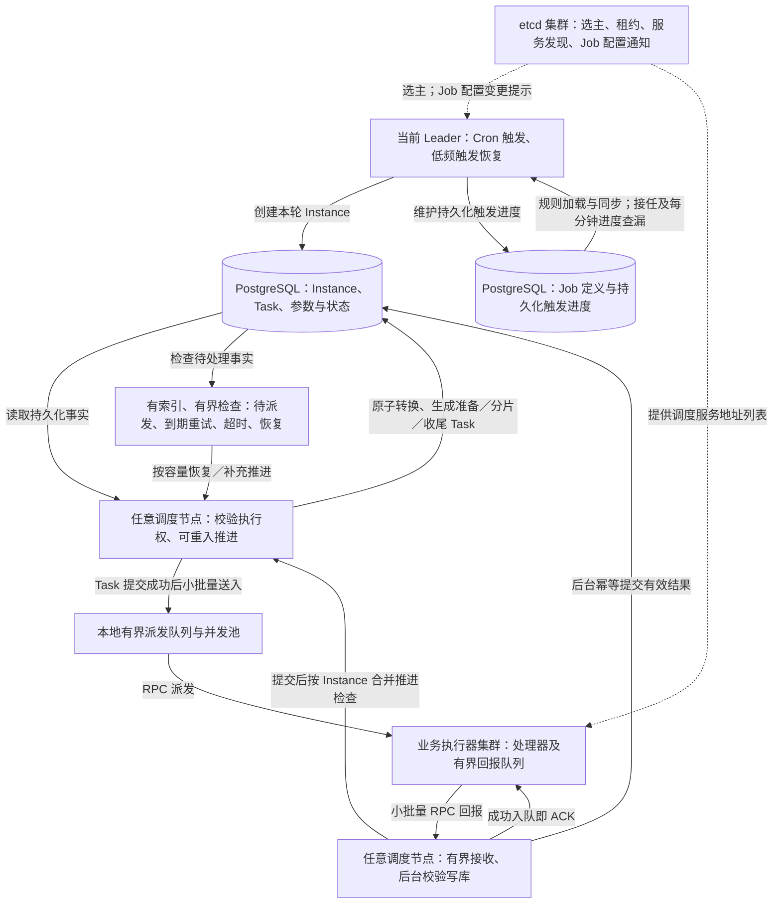

# 2 总体架构

本章说明系统由哪些角色组成、如何协作、由谁持有数据，以及主要技术选择的边界。**单 Leader 触发、无整轮归属的任务驱动架构、动态执行器组管理、部署接入及内部信任与依赖故障边界均已通过评审。** 第一阶段整体复核已通过，本章描述设计，不代表相应功能已经实现；状态转换与故障协议在第二阶段及[执行流程与可靠性](./execution.md)中继续展开。

## 2.1 架构总览

系统将“何时产生一轮执行”和“如何完成这轮执行”分开：etcd 选出的有效 Leader 维护定时规则、产生 Instance；所有调度服务副本均可基于持久化事实推进和派发 Task、接收结果，不为一个 Instance 指定持续负责到终态的节点。

准备、业务分片和业务收尾统一建模为 Task。正常路径在 Task 提交后，通过当前节点的有界队列直接派发；待处理与恢复检查负责补充积压、到期重试及中断的推进。执行器通过独立有界回报队列小批量发送结果，调度端成功入队即 ACK，后台校验并保存后才决定下一步。

两个 PostgreSQL 框表示同一数据库中的不同数据职责，不表示拆成两个数据库。Leader、推进、结果接收与检查是同一组调度服务副本承担的角色，不是四套独立集群。调度服务独立多副本部署；图中业务执行器使用公共执行组件，可嵌入所属业务 RPC 进程，也可在同业务域独立 Worker 中运行。

回报 ACK 不等待后台落库，不表示执行结果已被状态机采纳。两侧只使用有界内存缓冲；执行器回报独立有限重试，耗尽后释放并记录错误及丢弃指标，不占 Task 执行预算。节点退出或回报耗尽可能丢失未落库结果，完整接收、重传及恢复边界见[结果回报协议](execution.md#result-report)。

调度端已经 ACK 的结果遇到可恢复写库故障时，保留有界结果并退避重试，队满拒收新结果，不按固定次数或保留 TTL 主动清掉。该规则独立于执行器有限重报耗尽释放；进程退出仍可能丢失内存结果。容量按排队、处理中、待重试结果条数合计，结合固定消费并发及 RPC 报文上限控制，不做队列总字节／MB 精确配额，不另加业务结果长度限制或 Job 页面参数。永久无效数据不得无限重试阻塞整批，错误分类与批次隔离细节待契约设计，见[调度端结果保留](execution.md#scheduler-result-retention)。

## 2.2 角色与职责

| 角色 | 负责 | 不负责 |
| --- | --- | --- |
| 管理入口 | 维护执行器组与 Job 配置，查询执行情况，承接已纳入范围的管理操作 | 直接操作普通业务数据库、运行任务业务代码 |
| 触发 Leader | 维护长期定时规则，接任时及每分钟检查 Job 触发进度；通过同 Job 短事务创建 Instance、推进进度，应用错失和阻塞规则 | 等待整轮完成、逐个派发集群中的所有 Task |
| 调度服务副本 | 在取得必要执行权后推进阶段、生成和派发 Task、校验并保存结果、恢复待处理工作 | 解释商户、订单等业务数据，持有整轮固定归属 |
| 执行器公共组件 | 接收派发，保护执行容量，异步执行，管理执行上下文和协作式取消，回报结果 | 决定调度重试预算、直接更新调度表 |
| 业务处理器 | 解释和校验业务参数，执行所属业务逻辑，返回结果，保证副作用幂等 | 手写平台回报 RPC、推进 Instance 状态 |

这里是逻辑分工，不要求为每项职责创建独立进程或新增一层通用 Service。Leader 同时也是一个普通调度节点，可以承担推进、派发和结果接收工作。

### 对等节点如何协作

各调度节点按自身空闲容量取得待处理工作的必要执行权，不向 Leader 请求分配。一次执行的准备推进、分片结果接收和收尾推进可以发生在不同节点，不要求返回最初创建或派发的节点。

例如三个相同服务副本中，节点 A 当选 Leader 并创建 Instance；节点 B 取得准备工作的执行权并派发 PreTask，准备结果持久化后生成和派发分片；分片结果可由节点 C 接收，满足条件后再唯一创建 PostTask。A 失效时重新选主接替触发职责；其他阶段根据持久化工作恢复，不进行整轮负责人接管。

“对等”不表示同一工作可以无约束地并发推进。“无整轮归属”也不表示没有执行权校验、当前尝试标识或短事务并发保护。收尾创建使用 Instance 主键单行短事务与 PostTask 唯一性约束；新尝试登记与停止、超时、正常结束也通过[同一父行短事务](execution.md#authorization-terminal)协调。结果回报不统一锁父，等待重试只是候选，不是执行许可。正常路径仍由生成节点按容量有界登记、获得明确提交确认后直接派发；[提交结果不明](execution.md#commit-unknown)放弃本次本地发送，复用既有恢复。不把父锁扩大到全部结果写入或业务执行，生成权及具体 SQL 继续按模块设计。

## 2.3 技术选择与适用范围

| 技术 | 本系统中的用途 | 边界与尚待明确的事项 |
| --- | --- | --- |
| `github.com/robfig/cron/v3` | 固定六字段 Cron 解析与长期规则的内存定时触发，使用调度进程默认时区 | 不提供本系统的持久化错失补偿、计划身份防重或执行恢复；各时间计算入口的统一接入仍需实现 |
| etcd | 触发 Leader 选举、租约、RPC 服务发现与 Job 配置变更通知 | 官方 Session＋Election，租约部署初值 15 秒；选主与持久通知键分开。权威数据仍在 PostgreSQL，每任期独立上下文，不提供提交硬隔离或 Task 防重；RPC 请求不经过 etcd 转发 |
| PostgreSQL | Job、Instance、Task、参数与恢复事实的权威存储 | 状态语义、Task 条件登记及提交记账已确认，字段、索引与完整事务协议待设计；不以进程内缓存代替持久化事实 |
| go-zero RPC | 派发和回报复用原生发现与负载均衡；接单后条件绑定执行器，取消定向调用 | 不自行选择或排除派发节点，不保证重试换节点；RPC 负载均衡不感知全部异步业务执行容量；绑定缺失按有限观察及条件结算处理，已绑定无有效结果按既定等待规则处理，不新增 Task 活动查询或心跳 |
| 节点本地有界结构 | 派发与双端结果队列、工作协程池、按 Instance 合并的待检查集合 | 持久化状态决定推进；派发提示丢失可补查，未落库结果则可能丢失，不能从数据库重建原结果 |

调度核心自研，不以 Asynq 为底座。第一版不为派发和结果汇总引入 MQ、Redis 完成计数器、通用 DAG 或 MapReduce 计算框架，也不另行实现时间轮、最小堆或 Timer 调度器。

robfig v3.0.1 内部使用规则排序及每轮等待的 `time.Timer`，不是时间轮。它管理的是 Job 规则，不是所有分片 Task；第一版采用 500 条规则的[基准测试场景](scope.md#_1-6-质量目标与容量前提)，不能据此直接承诺密集触发时的吞吐，仍需验证。定时回调只做轻量触发，不执行准备、分片业务或等待整轮结束。

Cron、注册后检查和分钟恢复共用按 Job 合并的有界待处理队列，固定工作协程执行创建 Instance 的短事务，满时拒绝提示而不推进数据库进度。手动创建不进入自动队列，但共用本进程的创建并发额度；不增加分布式全局限流。实现初值为总容量 1024、创建并发 32、单次处理 3 秒，自动工作协程数随创建并发配置；该控制与 Task 派发、执行器容量分开。具体流程、调优边界及过载时仍可能错失的取舍见[触发容量与过载](execution.md#trigger-capacity)。

Leader 启动或接任时加载启用规则，管理变更提交后通过 etcd 通知，Leader 收到 Watch 提示后重新核对数据库，每 1 分钟兜底核对配置。PostgreSQL 仍是权威来源，通知只加速同步，不保证即时应用。另由 Leader 在接任时立即检查、任期内每 1 分钟按索引小批量检查 `Job.next_trigger_at`，恢复遗漏触发。配置同步与触发恢复是同一 Leader 进程内的两个独立后台循环，共同受任期控制，不串成先加载成功再恢复的依赖，也不要求同相位或同一条 SQL。正常触发不依赖高频到期 Job 轮询，但保留低频进度扫描，不宣称完全不查库。第一版不另加本地 Job 退避补试机制，恢复仍服从 5 秒错失规则；[配置同步](behavior.md#trigger-sync)、[低频恢复](behavior.md#trigger-recovery)与[同 Job 短事务](execution.md#trigger-accounting)已确认。

每次当选使用独立 `leaderCtx`，发现失主后取消该任期的触发、配置与恢复工作，不影响对等 Instance／Task 推进。取消不是数据库提交屏障：允许切主交界旧任期事务按最新 Job 合法提交，不增加全局数据库任期锁；管理变更与触发按同 Job 行协调。完整切主边界见[执行协议](execution.md#leader-config-boundary)。Job 配置采用每任期串行合并核对、主库轻量查询与差异应用，新注册或替换规则后补一次到期检查。监听建立、重连及失败处理见已通过的[配置加载与重载流程](execution.md#job-config-reload)。

首次完整装载在未启动的 Cron 中批量注册，启动并确认实际初始化完成后才提交注册后检查；热更新也按批次确认。本机旧任期完整清理后才重新参选，进程级连接、创建额度及对等职责跨任期复用；其他机器接任不等待旧机清理。资源与退出规则见[Leader 任期生命周期](execution.md#leader-runtime-lifecycle)。官方选主、15 秒租约初值、通知键与权限、有限发布及 Watch 恢复采用已通过的[etcd 接入约定](execution.md#etcd-integration)，不承诺在租约时长或 5 秒错失窗口内完成接任。

已有 Job 仅停用时可编辑，编辑不重设持久化触发进度，试算仅用于规则有效性校验；从停用切换为启用时，按当前配置重算 `next_trigger_at`，不补旧轮次。重复启用及规则重载不重置数据库进度，见[编辑与重新启用](behavior.md#job-edit-enable)。这不取消已有 Instance；已有轮次沿用创建时保存的[本轮执行配置](behavior.md#instance-execution-config)，Job 编辑只影响新建轮次。

## 2.4 数据所有权与服务边界

调度能力归属于 `job` 业务域，任务配置及执行记录由该域拥有。具体业务数据仍归原业务域所有，调度域不导入其他域的 Model、Repository，也不直接查询其他域的数据表；跨域通过 RPC 或版本化事件契约交互。同一业务域的后端进程可以复用本域数据层，API/BFF 不直接访问普通业务数据库。

| 状态 | 存放方向 | 用途与约束 |
| --- | --- | --- |
| 执行器组元数据 | PostgreSQL | 组名称、组标识、服务发现标识及组凭据；由管理入口维护，不保存静态机器清单，凭据保护方式待详细设计 |
| Job | PostgreSQL | 长期任务配置与持久化触发进度；平台配置普通列、业务参数独立载荷，见[存储分工](data-contracts.md#job-storage) |
| Instance | PostgreSQL | 一轮触发的身份、本轮执行配置、整体状态、首次开始与截止时间等；配置采用[必要独立列加 JSONB](data-contracts.md#instance-config-storage)。不保存整轮固定归属，不另维护阶段权威字段，展示阶段依据 Task 与生成事实推导 |
| Task | PostgreSQL | 业务执行单元、参数、派发与执行状态、目标执行器、重试及当前尝试、最早可派发时间；不建立独立 Attempt 表，具体字段待设计 |
| Leader 协调信息 | etcd | 选主租约及任期相关信息；本地每任期独立上下文，不另设数据库全局任期锁 |
| 临时状态 | 各节点内存 | 连接、缓存、派发队列、待推进集合、在途调用与回报结果；未落库结果可以仅存于内存，不承诺节点退出后保留 |

节点可以拥有缓存和正在处理的工作，但持久化授权、状态及推进不依赖某个固定节点存活。本地提示、回调及计时丢失不应丢失数据库中的工作；尚未落库的结果则允许随进程退出丢失。已有持久化绑定但无有效结果时，当前尝试保持执行中，等待有效结果、人工停止或整轮截止；无绑定仍按有限观察和条件结算处理，不依赖恢复原节点文件。

### 结果为什么经调度服务写入

执行器通过服务发现取得调度服务地址，由其 RPC 客户端选择可用节点并提交结果，不要求请求 Leader 或原派发节点。接收节点完成基础鉴权和报文校验，**成功进入有界结果队列即返回接收 ACK**；后台再校验 Task 所属组、当前执行尝试及更新前状态条件，幂等提交有效结果，提交后进行整轮检查和后续推进。

业务执行器不直接写调度表，避免将调度表结构、数据库权限和状态推进规则分散到每个业务程序。公共执行组件负责回报，处理器只返回结果。回报用于持久化执行状态，不另存一份重复业务日志；它也不同于业务 `Notify` 回调，后者不纳入第一版。

平台允许有界重试与故障恢复造成重复业务执行，不承诺业务恰好一次；仍负责执行尝试隔离、回报幂等、任务创建防重和终态保护。业务处理器负责业务效果幂等。这两个责任不能相互替代，具体规则见[行为规则](./behavior.md)，推进协议见[执行流程与可靠性](./execution.md)。

## 2.5 统一执行入口与两层路由

执行器采用统一 RPC 派发入口。请求到达后，执行器按处理器名称定位本地注册的业务代码，再依据 Task 类型执行普通处理、准备、分片或收尾。新增业务任务不逐个增加 RPC 方法；在既有执行协议能够表达的范围内，业务方编写并显式注册具名 Processor，在 Job 配置中引用其名称。

| 路由层次 | 要解决的问题 | 已确认方式 |
| --- | --- | --- |
| 服务实例路由 | 请求发给哪个业务程序的哪个执行器实例 | Job 选择执行器组，组元数据定位服务发现范围，再由 go-zero 原生发现与负载均衡选择实例 |
| 业务代码路由 | 到达该实例后运行哪段业务逻辑 | 统一入口根据处理器名称查找本地注册处理器，由 Task 类型区分阶段 |

统一入口是多个执行器实例共同实现的协议，不是新增一个单点转发服务，也不代表所有业务程序必须共享一个发现范围。组定位业务程序的发现范围，处理器名称定位该程序内的代码；只填写处理器名称不足以确定目标业务程序。

同组参与负载均衡的副本必须兼容该组已启用 Job 所用的处理器与参数契约。原生负载均衡不按处理器名称筛选代码版本；新增处理器应先完成组内兼容部署，再启用引用它的 Job。处理器下线及版本变更对存量待执行和重试任务的影响，在详细契约中继续约束，不扩展为能力协商或版本路由平台。

派发 RPC 返回的是接收结果，不等待业务结束；接收成功不等于执行成功。业务完成通过独立回报链路提交。首次派发和重试均走原生负载均衡，不自行选择“另一个节点”，也不承诺均衡分摊异步任务的执行负载。

执行器接单响应提供本次启动的进程实例标识；调度端结合实际对端地址，条件持久化当前尝试的执行器绑定。取消使用该绑定定向调用并校验进程标识，不通过组内负载均衡随机选节点。绑定在接单之后保存，存在 ACK 丢失或绑定提交前宕机导致目标未知的窗口；已确认从尝试登记的数据库时间有限观察、到期条件结算，服从原预算及父终止规则，接受业务可能重复或结果不确定失败。已有持久化绑定但无有效结果时不因失联、重启、回报耗尽或 ACK 后丢失提前重派；第一版不新增 Task 活动查询、心跳或独立失联判断机制。具体路由见[执行器身份绑定](execution.md#executor-binding)，故障边界见[绑定缺失处理](execution.md#missing-binding)与[已绑定结果等待](execution.md#bound-result-wait)；具体观察期和事务实现仍待闭合。

go-zero 当前默认的 `p2c_ewma` 使用 RPC 时延、在途调用等信息选择连接，不掌握已接收异步 Task 的剩余计算量。RPC 接收确认返回后业务可能继续运行很久，因此调度端的 RPC 并发限制不能代替执行器容量保护。[BUSY 背压](execution.md#busy-backpressure)已确认只用于执行器明确容量满且未接单、未入队、未执行的拒绝：当前有效尝试条件返还已占用机会并延期，不消耗执行预算，零重试也可延期。复用最早可派发时间和既有检查，不增加队列或扫描；后续仍由原生负载均衡选址，不保证换节点。通信超时、断连、Unavailable 及 BUSY 答复丢失不能推断为可返还的 BUSY；两端容量、公平性、退避数值与具体条件写入继续在[执行流程与可靠性](./execution.md)中细化。

公共执行组件的注册 API、RPC 消息和处理器方法签名尚未确定，不照搬 Java 注解扫描方式。处理器名称及业务参数是双方契约，后续需要明确校验和兼容规则，见[数据与接口](./data-contracts.md)。

### 动态执行器组管理

第一版提供基础执行器组管理页面，由 `job` 域在 PostgreSQL 中保存组名称、组标识和对应的服务发现标识。Job 选择组与具名处理器；执行器通过 go-zero 注册实例地址到 etcd，由原生服务发现和负载均衡承接地址变化与节点选择。

新增业务组不要求逐台修改或重启调度服务来增加组映射。业务方仍须部署相应执行程序，并使其注册到组对应的发现范围；页面建组不会自动部署业务代码，也不等于已经有可用实例。现有组扩缩容只改变动态发现的实例集合，不维护静态 IP 清单。

第一版一个执行器进程只归属一个组，配置该组标识和 Token；同组多个实例共享组 Token，每个进程可以提供多个具名处理器。组用于定位一组兼容的业务程序，不是每个 Job 或处理器各建一个组。相同程序可以通过不同部署配置分别启动为不同组，不提供单进程同时加入多个组的配置模式。

业务接入先建立服务端组配置，再配置执行器的组、凭据及发现范围；实例出现不会自动创建组。实例地址由 go-zero 直接注册到 etcd，不增加执行器向调度服务注册的 RPC，也不另建数据库心跳注册中心。注册认证与任务调用认证分别见[内部信任边界](#internal-trust)。

调度节点复用组配置缓存与 RPC 客户端，不为每次派发额外查询组表或新建连接。第一版无组启停，仅逻辑删除；[组引用与删除保护](data-contracts.md#executor-group-lifecycle)及触发模块所需正式组依赖已确认。组更名、发现目标变更、凭据和连接缓存失效仍须在组模块明确，不能把配置保存成功当成所有副本已立即应用，也不能把删除组当成停止执行器进程。

该能力替代“部署配置静态维护组与发现目标映射”的建议。它只管理业务接入与寻址，不引入手工机器编排、自定义负载均衡或高级资源调度；组配置不代替 etcd 访问授权，也不自动部署执行器。

## 2.6 选择理由与扩展边界

2026-10-09 的架构评审选择了当前方案，当时编号为“架构 B”。被替代的方案为每个 Instance 设置一个负责人，由其持续推进到整轮终态，并维护归属、续租和接管。当前方案取消这层整轮归属，以持久化 Task、执行尝试和可重入推进作为协调基础。

这样可以让等待远端分片结果的 Instance 不依赖原推进节点存活，并统一准备、分片和收尾的可靠执行机制。代价是生成、派发、回报与推进仍需明确原子性和恢复协议，不能把去掉负责人理解为去掉协调。

性能边界同样需要保留：

- 单 Leader 只集中触发职责，但仍有触发规划的容量上限；第一版不采用按 Job 分桶的多活触发。
- 正常路径在持久化后本地直接派发，降低等待扫描的延迟；单个大 Instance 的初始派发仍受当前派发节点能力限制。
- 其他可用节点可以在安全取得执行权后恢复或补充待处理工作，但不把所有正常步骤改为全体节点持续争抢的两层轮询。
- 结果在接收节点按 Instance 合并检查，不等于全局只查询一次；不同 Instance 的稀疏结果难以合并。
- 统一 Task 模型利于协议复用，不直接证明吞吐提高；选择当前架构不是性能压测结论。

容量边界、恢复成本和公平性需通过[验证与交付](./verification.md)确认，不承诺所有负载下均优于被替代方案。

服务发现继续使用 etcd＋go-zero，而不采用 SnailJob 式由调度服务维护心跳注册表、同步地址缓存和剔除过期实例的方案。两种路线都能支持多副本；DogX 已选择 etcd 选主和原生 RPC，复用注册、租约与地址监听可减少自研的注册生命周期代码，不是认定自管注册天然不可靠。代价是需要运维 etcd、管理执行器的注册权限，且选主与发现共享其故障影响。相关实现与参考边界见[参考资料](references.md#internal-trust-evidence)。

服务发现只提供候选地址，不证明处理器兼容、执行器有剩余容量或某个 Task 正常运行。租约或心跳失效也不证明业务已经退出；任务执行权、回报和故障恢复仍由执行协议保障，不能由注册状态代替。

## 2.7 部署与规范衔接

调度能力集成于 DogX 一体化后台，后端保持同一 Git 仓库和一个 Go Module。管理页面复用 `dogx-web`，管理调用链为 `system-api → job-rpc → PostgreSQL`；已确认的[工程目录](../../adr/0009-scheduler-domain-and-etcd.md#project-layout)沿用 System BFF 与独立 Job 业务域，不新增 `job-api` 或独立调度产品。

公共执行组件在仓库内复用，不独立发布对外 SDK；业务处理器留在所属业务域，不导入 Job 的内部模型或 Repository。`jobclient` 是供管理入口等调用 Job RPC 的生成客户端，不等于执行器运行组件。公共组件的具体包路径和处理器接口在执行模块设计时确定，不因本次目录确认提前定案。

调度服务独立进程、多副本部署，每个副本同时具备调度 RPC 服务端、执行器 RPC 客户端、Leader 竞选、推进及恢复能力；不把 Leader 或派发节点再拆成专用部署。业务代码留在所属业务程序中，不编译进调度服务。

执行器是业务程序通过公共组件获得的运行能力，不强制每个业务都额外部署服务。两种部署方式使用同一套执行协议：

| 部署方式 | 适用与边界 |
| --- | --- |
| 嵌入所属业务 RPC 进程 | 适合轻量任务；统一执行服务可与业务服务共用 gRPC Server、端口和发现范围，但共享进程资源，不构成资源隔离 |
| 同业务域独立 Worker | 适合 CPU、内存密集或长时间运行的任务；包含本域处理器，可按仓库规范复用本域数据层，独立部署和扩缩容，使用对应发现范围 |

嵌入模式不强制为同一个地址额外维护第二套注册。组可对应该业务 RPC 已有的发现范围，前提是其中可选副本都提供兼容执行服务；独立 Worker 则使用其自身的发现范围。执行器的具体发现标识格式、启动入口与 Worker 目录在执行模块设计中确定，不固定建立三套调度相关进程。

调度节点按发现目标复用 RPC 客户端，不按 Job 或 Task 新建连接。执行器回报同样使用调度集群的发现配置，不固定回到原派发节点或 Leader；定向取消所需节点身份和路由另由执行协议设计，不能用随机组内派发替代。

第一版不提供任意 HTTP／RPC 目标配置，业务通过统一入口和具名处理器接入；处理器内部仍可按业务需要调用其他服务。

### 内部信任边界 {#internal-trust}

第一版面向受运维控制的内部业务执行器，不托管不可信第三方代码。管理后台用户身份、组级机器凭据与基础设施访问凭据分别管理，不能用管理员登录 JWT 代替执行器认证。

| 交互 | 认证与授权责任 | 边界 |
| --- | --- | --- |
| 管理组、Job、手动执行及停止 | DogX 登录和菜单／API 角色权限 | 不限定为超级管理员专属 |
| 实例注册与发现 | go-zero 向 etcd 注册和订阅，etcd 认证及所需读写范围权限控制 | 执行器不得任意改写调度服务、其他组发现范围或选主数据；组 Token 不参与 etcd 认证 |
| 调度服务派发／取消 | 使用目标组 Token；执行器校验 Token 及目标组后进入执行协议 | 取消还需匹配目标执行身份，不以随机组内调用代替定向取消 |
| 执行器回报结果 | 入队前校验组 Token 及报文；后台写库前校验持久化 Task 所属组、当前有效尝试及更新前状态条件 | 接收 ACK 不代表修改授权；不能仅凭请求自报的组或知道 Token 就修改任意 Task |

Token 是按组管理的静态共享口令，不是 JWT，不自带登录会话或到期语义。不得使用公开固定默认值，也不得因凭据为空或无法取得可用凭据而跳过认证；凭据生成、缓存和部署注入见[管理与运维](operations.md#group-credentials)。具体认证字段、比较实现、存储保护、轮换及缓存失效时效仍需详细设计。

etcd 注册成功不代表组 RPC 认证通过。例如 etcd 权限正确但组 Token 配错时，实例仍可能进入发现列表，任务调用则应被拒绝；不能把组 Token 描述成注册准入凭据。共享 Token 也不能证明具体进程身份，不能防止持有同组凭据的恶意节点冒充调用方，不构成不可信租户间的强隔离。

内部 RPC 不直接暴露公网，访问范围由部署网络约束；Token 只做凭据校验，不负责传输加密，跨不可信网络需使用 TLS 等传输保护。第一版不自建证书管理平台。PostgreSQL、etcd、调度 RPC 和业务依赖的故障边界及启动就绪要求见[依赖故障与恢复边界](operations.md#dependency-boundaries)。

### 规范衔接

实现继续遵守仓库分层和数据库规范：默认 `READ COMMITTED`；显式锁仅在短事务中按单表主键等值锁定一行；事务内不进行 RPC、Redis 等外部 I/O。已确认的收尾创建、新尝试登记与终态协调均遵守这一约束；接受按 Instance 有界批次协调的额外成本，不借此放开普通列表的逐条查询。etcd 与现有 Redis 跨进程协调规范的适用边界已由 [ADR-0009](../../adr/0009-scheduler-domain-and-etcd.md)确认；当前暂不编码，生效规范的同步留待实现时完成。

## 2.8 待补齐与完成条件

| 待补齐内容 | 解决阶段 | 完成条件 |
| --- | --- | --- |
| 执行器组生命周期与配置同步 | 核心详细设计／组管理模块实现前 | 无组启停、逻辑删除及引用保护已定；补齐更名、发现目标变更、凭据与缓存失效协议，配置更新不无意改变在途执行 |
| 内部认证与部署细则 | 核心详细设计／相关模块实现前 | 在已通过的组凭据和独立 etcd 授权边界内，明确字段、存储保护、轮换、缓存时效及最小访问范围 |
| 依赖恢复与能力就绪实现 | 核心详细设计／相关模块实现前 | 按第 7 章已定故障边界落实启动、重连、能力就绪与有界回报重传，分别验证冷启动和运行中故障 |
| 选主实现、配置同步及工作执行权协议 | 核心详细设计 | 落实已定任期生命周期、Job 通知与差异重载流程及各工作执行权；接受旧合法事务提交，不允许凭旧快照非法创建工作或覆盖有效结果 |
| RPC、处理器契约及连接管理 | 核心详细设计／相关模块实现前 | 发现标识格式、契约、校验、兼容和生命周期明确，且不改变已确认的部署方式、统一入口与原生负载均衡边界 |
| 架构 ADR 与仓库规范衔接 | 相关实现前 | 已确认的关键取舍及 etcd 例外形成可执行的记录，规范无冲突 |

本章的架构收口以角色、部署、数据所有权、依赖和信任边界完整为标准，不以所有参数和方法签名已经确定为标准。后续议题的顺序由[设计进度](./progress.md)统一安排。
