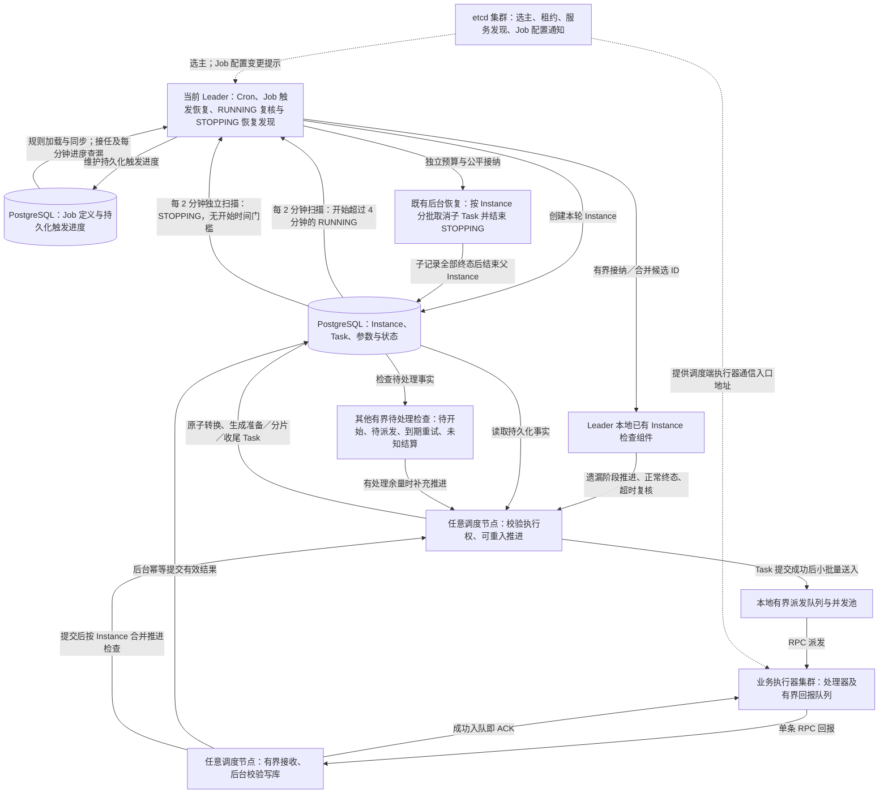

# 2 总体架构

本章说明系统由哪些角色组成、如何协作、由谁持有数据，以及主要技术选择的边界。**单 Leader 触发、无整轮归属的任务驱动架构、动态执行器组管理、部署接入及内部信任与依赖故障边界均已通过评审。** 第一阶段整体复核已通过，本章描述设计，不代表相应功能已经实现；状态转换与故障协议在第二阶段及[执行流程与可靠性](./execution.md)中继续展开。

## 2.1 架构总览

系统将“何时产生一轮执行”和“如何完成这轮执行”分开：etcd 选出的有效 Leader 维护定时规则、产生 Instance，并承担 RUNNING Instance 的低频统一复核及 STOPPING Instance 的停止恢复候选发现；所有调度服务副本均可基于持久化事实推进和派发 Task、接收结果，不为一个 Instance 指定持续负责到终态的节点。正常结果保存后由接收节点立即通知本地检查组件，不等待 Leader 或周期扫描。

准备、业务分片和业务收尾统一建模为 Task。正常路径在 Task 提交后，通过当前节点的有界队列直接派发；待处理与恢复检查负责补充积压、到期重试及中断的推进。执行器通过独立有界回报队列单条异步发送结果，调度端成功入队即 ACK，后台校验并保存后才决定下一步。



两个 PostgreSQL 框表示同一数据库中的不同数据职责，不表示拆成两个数据库。Leader、推进、结果接收与检查是同一组调度服务副本承担的角色，不是独立集群。图中的 Leader 本地检查组件及 STOPPING 后台处理复用已有组件，不新增恢复处理队列或跨节点转发；停止决定提交后也会立即提交本地处理，不必等周期扫描。RUNNING 与 STOPPING 的查询、分页和预算分别管理，其他待处理检查保持各自既有协议，其节点分工、周期和容量按各自模块细化，不由本图统一决定。调度服务独立多副本部署；图中业务执行器使用公共执行组件，可嵌入所属业务 RPC 进程，也可在同业务域独立 Worker 中运行。

回报 ACK 不等待后台落库，不表示执行结果已被状态机采纳。两侧只使用有界内存缓冲；执行器回报独立有限重试，耗尽后释放并记录错误及丢弃指标，不占 Task 执行预算。节点退出或回报耗尽可能丢失未落库结果，完整接收、重传及恢复边界见[结果回报协议](execution.md#result-report)。

调度端已经 ACK 的结果逐条关联查询 Task／Instance 归属、认证组和本轮冻结重试配置，再按原尝试、执行中状态及绑定身份条件 UPDATE、独立提交，不合并提交、不设置整批总超时或超时拆批。[调度端结果保存安排与初值](execution.md#scheduler-result-defaults)已定为每节点组件默认保留 512 条待首次处理、待重试及在途结果，保存并发 8，单条一次处理超时 2 秒，三项均可部署调整；2 秒覆盖连接等待、读取、更新及提交，不包含排队和退避。一次处理结束即释放处理能力，退避保留原条目原位置；按已到期最早可处理时间及稳定同时间顺序选择，不切首次／重试固定份额。退避基准 1／2／4／8／16／30 秒、以后封顶 30 秒，各次上下浮动 20%。可恢复故障及提交不明不按次数或 TTL 丢结果，零行正常结束但不证明此前保存成功，不重放其他已明确成功的条目；满载拒收新结果，即使全部条目在退避。512 是结果组件内部的保留上限，不与业务接单、执行共用额度，也不另建无界重试缓冲。不做队列总字节／MB 精确配额，不另加业务结果长度限制或 Job 页面参数。永久无效条目按[回报错误分类](data-contracts.md#result-error-classification)所需证据处理；认证／参数错误沿用现有机制，通用资源不足及未知错误有限重传，SQL／驱动适配及实现验证仍待完成；共享 30 秒停机宽限及易失边界不变。

## 2.2 角色与职责

| 角色 | 负责 | 不负责 |
| --- | --- | --- |
| 管理入口 | 维护执行器组与 Job 配置，查询执行情况，承接已纳入范围的管理操作 | 直接操作普通业务数据库、运行任务业务代码 |
| 调度 Leader | 维护长期定时规则，接任时及每分钟检查 Job 触发进度；通过同 Job 短事务创建 Instance、推进进度，应用错失和阻塞规则；另按已定周期分别发现 RUNNING 复核与 STOPPING 停止恢复候选，交本地已有检查／后台恢复组件 | 持有整轮归属、等待整轮完成、逐个派发集群中的所有 Task |
| 调度服务副本 | 在取得必要执行权后推进阶段、生成和派发 Task、校验并保存结果、恢复待处理工作 | 解释商户、订单等业务数据，持有整轮固定归属 |
| 执行器公共组件 | 接收派发，有界排队并限制业务并发，管理执行上下文和协作式取消，独立回报结果 | 决定调度重试预算、直接更新调度表 |
| 业务处理器 | 解释和校验业务参数，执行所属业务逻辑，返回结果，保证副作用幂等 | 手写平台回报 RPC、推进 Instance 状态 |

这里是逻辑分工，不要求为每项职责创建独立进程或新增一层通用 Service。Leader 同时也是一个普通调度节点，可以承担推进、派发和结果接收工作。

### 对等节点如何协作

各调度节点按自身空闲容量取得待处理工作的必要执行权，不向 Leader 请求分配。一次执行的准备推进、分片结果接收和收尾推进可以发生在不同节点，不要求返回最初创建或派发的节点。RUNNING Instance 的周期复核和 STOPPING Instance 的周期恢复候选仅由 Leader 发现并交其本地既有组件，不广播到全体节点，也不把正常结果或已提交的停止决定统一转发给 Leader。

例如三个相同服务副本中，节点 A 当选 Leader 并创建 Instance；节点 B 取得准备工作的执行权并派发 PreTask，准备结果持久化后生成和派发分片；分片结果可由节点 C 接收，满足条件后再唯一创建 PostTask。A 失效时重新选主接替触发、RUNNING 复核和 STOPPING 恢复候选发现；其他阶段根据持久化工作恢复，不进行整轮负责人接管。

“对等”不表示同一工作可以无约束地并发推进。“无整轮归属”也不表示没有执行权校验、当前尝试标识或短事务并发保护。收尾创建使用 Instance 主键单行短事务与 PostTask 唯一性约束；新尝试登记仍保留父短事务及截止校验，正常完成则在父锁外读稳定完成事实，再条件 UPDATE。更新自身的行锁与新授权、停止和超时写入参与[同一父行协调](execution.md#authorization-terminal)，不要求正常完成先显式锁父再查 Task。结果回报不统一锁父，等待重试只是候选，不是执行许可。正常路径仍由生成节点按容量有界登记、获得明确提交确认后直接派发；[提交结果不明](execution.md#commit-unknown)放弃本次本地发送，复用既有恢复。不把父锁扩大到全部结果写入或业务执行，生成权及具体 SQL 继续按模块设计。

2026-10-26 已单独批准[派发候选合并与跨节点竞争](execution.md#dispatch-contention)：普通首次启动与已有 Task 新尝试登记把原等待式父锁改为父主键 NOWAIT，冲突回滚、跳过本次同 Instance 候选组，处理其他 Instance，不立即重新排队。本地合并重复候选，同 Instance 同时只做一个登记事务，限制不跨 RPC；补查独立小幅抖动，已接纳候选分组后不同起点处理，SQL 仍按索引有序查询。该修订不扩大到生成、Post 创建或停止决定的父事务，不改变正常提交后本地派发、对等接续及 64 并发；2026-10-28 的[排队、并发与满载处理](execution.md#capacity-model)已确认共享派发不切来源固定份额、Instance 小批轮转。同日通过的[派发供给参数](execution.md#dispatch-supply-defaults)进一步确定等待候选 256、每页最多 128、空闲补查 1 秒上下浮动 20%、每 Instance 先补最多 8 项及连续 4 页无有效登记进展时退避；两类补查使用各自临时上界和游标，不形成永久水位。登记批量、分片首次可派发查询及具体编码组织仍待落实。NOWAIT 不是整条链路无等待或性能必胜，跨节点重复读取及子 UPDATE 竞争仍然存在。

[排队、并发与满载处理](execution.md#capacity-model)以正常处理效率、过载保护和可维护性共同决定方案：限制主要队列、业务与外部操作并发，允许各段有限结构自然形成整体边界；回报和取消应能独立处理，但不为每个内部步骤机械增加处理池、队列或统一配额。具体 Go 组织方式结合完整生命周期选择，额外协调机制须说明实际收益。

执行器采用已确认的[接单、执行与结果交接流程](execution.md#executor-processing-flow)：接单后进入有界业务等待队列，由有限并发的处理者执行业务，再交给有界结果队列，由独立且有限并发的回报处理发送。普通、准备、分片及收尾共享进程内的业务队列和处理能力，不随 Job／Instance 数量各建一套；实际接纳后才 ACK，业务等待队列无法接纳的新请求返回 BUSY，ACK 不承诺业务已开始。

回报组件保留位置已满时，业务已返回的有限处理者持有结果等待交接，暂不领取下一项业务，独立回报继续进行；结果成功交接后再继续消费。业务实际退出即清理活动防重记录，不因本地交接等待或远端 ACK 延长；正在运行的业务仅收到取消信号时仍未退出。长业务不可抢占，不保证短任务或特定阶段立即执行。[业务处理初值](execution.md#executor-business-defaults)已定为每执行器进程并发 32、等待队列 128，均可按部署调整；32 包括业务运行及已完成但结果尚未交接完的处理，128 只计尚未领取的等待任务、不含处理中。普通、准备、分片和收尾共享，不按 Job／Instance 叠加，也不预定 Go 线程结构。不新增负载心跳、容量感知路由或持久消息基础设施，也不改变已定停止及恢复规则。

[执行器结果保留](execution.md#executor-result-queue)默认最多 256 条，待首发、待重试和在途共用这些位置；收到 ACK、永久错误或调用次数耗尽后才释放。发送并发默认 16，单次 RPC 结束即释放发送能力，等待退避不占发送并发，也不释放或重新争抢原结果位置。新结果以接纳时刻为最早可发送时间，重试以上次调用结束加正退避计算；只选已到期结果，按最早时间及稳定同时间顺序处理，不切首发／重试固定份额。这只是回报组件的局部结果保留上限，不与接单、业务等待和业务执行共用全生命周期额度。

[回报初值](execution.md#reporting-defaults)将 256 条结果和 16 并发作为部署配置；单次 RPC 2 秒、最多 7 次应用层调用含首次、六次退避 1／2／4／8／16／16 秒且各上下浮动 20%，采用集中内部常量。基准退避合计 47 秒，不是结果保留 TTL 或完成时限；停机仍共享整个进程的 30 秒宽限，未确认结果仍可能丢失。[调度端结果保存安排与初值](execution.md#scheduler-result-defaults)另已通过组件保留 512、保存并发 8、单条处理 2 秒及不占处理能力的退避安排，不套用执行器业务 32／128 或回报 256／16；[回报错误分类](data-contracts.md#result-error-classification)已通过，派发／取消的完整错误编码、SQL／实现验证及其余恢复、分片等未闭合事项保持原范围。

## 2.3 技术选择与适用范围

| 技术 | 本系统中的用途 | 边界与尚待明确的事项 |
| --- | --- | --- |
| `github.com/robfig/cron/v3` | 固定六字段 Cron 解析与长期规则的内存定时触发，使用调度进程默认时区 | 不提供本系统的持久化错失补偿、计划身份防重或执行恢复；各时间计算入口的统一接入仍需实现 |
| etcd | 触发 Leader 选举、租约、RPC 服务发现与 Job 配置变更通知 | 官方 Session＋Election，租约部署初值 15 秒；选主与持久通知键分开。权威数据仍在 PostgreSQL，每任期独立上下文，不提供提交硬隔离或 Task 防重；RPC 请求不经过 etcd 转发 |
| PostgreSQL | Job、Instance、Task、参数与恢复事实的权威存储 | 状态语义、Task 条件登记及提交记账、普通 Task 公共字段与单例唯一约束已确认；Task 查询索引、分片字段及完整事务协议待细化，不以进程内缓存代替持久化事实 |
| go-zero RPC | 派发和回报复用原生发现与负载均衡；接单后条件绑定执行器，取消定向调用 | 不自行选择或排除派发节点，不保证重试换节点；RPC 负载均衡不感知全部异步业务执行容量；绑定缺失按有限观察及条件结算处理，已绑定无有效结果按既定等待规则处理，不新增 Task 活动查询或心跳 |
| 节点本地排队与并发处理 | 派发和业务等待队列、双端结果队列、受控并发处理、按 Instance 合并的待检查集合 | 持久化状态决定推进；派发提示丢失可补查，未落库结果则可能丢失，不能从数据库重建原结果；具体 Go 组织方式按组件流程选择 |

调度核心自研，不以 Asynq 为底座。第一版不为派发和结果汇总引入 MQ、Redis 完成计数器、通用 DAG 或 MapReduce 计算框架，也不另行实现时间轮、最小堆或 Timer 调度器。

robfig v3.0.1 内部使用规则排序及每轮等待的 `time.Timer`，不是时间轮。它管理的是 Job 规则，不是所有分片 Task；第一版采用 500 条规则的[基准测试场景](scope.md#quality-baseline)，不能据此直接承诺密集触发时的吞吐，仍需验证。定时回调只做轻量触发，不执行准备、分片业务或等待整轮结束。

Cron、注册后检查和分钟恢复共用按 Job 合并的有界待处理队列，固定工作协程执行创建 Instance 的短事务，满时拒绝提示而不推进数据库进度。手动创建不进入自动队列，但共用本进程的创建并发额度；不增加分布式全局限流。实现初值为总容量 1024、创建并发 32、单次处理 3 秒，自动工作协程数随创建并发配置；该控制与 Task 派发、执行器容量分开。具体流程、调优边界及过载时仍可能错失的取舍见[触发容量与过载](execution.md#trigger-capacity)。

Leader 启动或接任时加载启用规则，管理变更提交后通过 etcd 通知，Leader 收到 Watch 提示后重新核对数据库，每 1 分钟兜底核对配置。PostgreSQL 仍是权威来源，通知只加速同步，不保证即时应用。另由 Leader 在接任时立即检查、任期内每 1 分钟按索引小批量检查 `Job.next_trigger_at`，恢复遗漏触发。配置同步与触发恢复是同一 Leader 进程内的两个独立后台循环，共同受任期控制，不串成先加载成功再恢复的依赖，也不要求同相位或同一条 SQL。正常触发不依赖高频到期 Job 轮询，但保留低频进度扫描，不宣称完全不查库。第一版不另加本地 Job 退避补试机制，恢复仍服从 5 秒错失规则；[配置同步](behavior.md#trigger-sync)、[低频恢复](behavior.md#trigger-recovery)与[同 Job 短事务](execution.md#trigger-accounting)已确认。

每次当选使用独立 `leaderCtx`，发现失主后取消该任期的触发、配置、Job 恢复、RUNNING 复核及 STOPPING 恢复候选发现，丢弃本地临时扫描位置，不影响正常对等 Instance／Task 推进。已交接给进程级 Instance 检查组件的候选可以按原数据库协议完成，不因失主清空该组件。取消不是数据库提交屏障：允许切主交界旧任期事务按最新 Job 合法提交，不增加全局数据库任期锁；管理变更与触发按同 Job 行协调。完整切主边界见[执行协议](execution.md#leader-config-boundary)。Job 配置采用每任期串行合并核对、主库轻量查询与差异应用，新注册或替换规则后补一次到期检查。监听建立、重连及失败处理见已通过的[配置加载与重载流程](execution.md#job-config-reload)。

首次完整装载在未启动的 Cron 中批量注册，启动并确认实际初始化完成后才提交注册后检查；热更新也按批次确认。本机旧任期完整清理后才重新参选，进程级连接、创建额度及对等职责跨任期复用；其他机器接任不等待旧机清理。资源与退出规则见[Leader 任期生命周期](execution.md#leader-runtime-lifecycle)。官方选主、15 秒租约初值、通知键与权限、有限发布及 Watch 恢复采用已通过的[etcd 接入约定](execution.md#etcd-integration)，不承诺在租约时长或 5 秒错失窗口内完成接任。

已有 Job 仅停用时可编辑，编辑不重设持久化触发进度，试算仅用于规则有效性校验；从停用切换为启用时，按当前配置重算 `next_trigger_at`，不补旧轮次。重复启用及规则重载不重置数据库进度，见[编辑与重新启用](behavior.md#job-edit-enable)。这不取消已有 Instance；已有轮次沿用创建时保存的[本轮执行配置](behavior.md#instance-execution-config)，Job 编辑只影响新建轮次。

## 2.4 数据所有权与服务边界

调度能力归属于 `job` 业务域，任务配置及执行记录由该域拥有。具体业务数据仍归原业务域所有，调度域不导入其他域的 Model、Repository，也不直接查询其他域的数据表；跨域通过 RPC 或版本化事件契约交互。同一业务域的后端进程可以复用本域数据层，API/BFF 不直接访问普通业务数据库。

| 状态 | 存放方向 | 用途与约束 |
| --- | --- | --- |
| 执行器组元数据 | PostgreSQL | 数据库 ID、作为接入身份的组名、手动配置的发现 Key 及组凭据；不保存静态机器清单。组名和 Key 创建后固定，第一版不修改或重置已有 Token；未命中回源、每节点 60 秒完整快照替换、详情查看、已删组客户端清理及启动退出规则已定，具体装配仍待实现 |
| Job | PostgreSQL | 长期任务配置与持久化触发进度；平台配置普通列、业务参数独立载荷，见[存储分工](data-contracts.md#job-storage) |
| Instance | PostgreSQL | 一轮触发的身份、本轮执行配置、整体状态、首次开始与截止时间等；配置采用[必要独立列加 JSONB](data-contracts.md#instance-config-storage)。不保存整轮固定归属，不另维护阶段权威字段，展示阶段依据 Task 与生成事实推导 |
| Task | PostgreSQL | 统一 `job_task` 保存执行状态、`attempt_no`、`used_attempts`、当前绑定、结果和运行时间；公共配置读取 Instance，不建立独立 Attempt 表。[普通公共字段与单例约束](data-contracts.md#task-field-contract)已通过，分片输入／编号及具体状态写入仍待设计 |
| Leader 协调信息 | etcd | 选主租约及任期相关信息；本地每任期独立上下文，不另设数据库全局任期锁 |
| 临时状态 | 各节点内存 | 连接、缓存、派发队列、待推进集合、在途调用与回报结果；未落库结果可以仅存于内存，不承诺节点退出后保留 |

节点可以拥有缓存和正在处理的工作，但持久化授权、状态及推进不依赖某个固定节点存活。本地提示、回调及计时丢失不应丢失数据库中的工作；尚未落库的结果则允许随进程退出丢失。已有持久化绑定但无有效结果时，当前尝试保持执行中，等待有效结果、人工停止或整轮截止；无绑定仍按有限观察和条件结算处理，不依赖恢复原节点文件。

### 结果为什么经调度服务写入

执行器通过服务发现取得调度端执行器通信入口的地址，由其 RPC 客户端选择可用节点并提交结果，不调用管理入口，也不要求请求 Leader 或原派发节点。接收节点完成基础鉴权和报文校验，**成功进入有界结果队列即返回接收 ACK**；后台再校验 Task 所属组、当前执行尝试及更新前状态条件，幂等提交有效结果，提交后进行整轮检查和后续推进。

业务执行器不直接写调度表，避免将调度表结构、数据库权限和状态推进规则分散到每个业务程序。公共执行组件负责回报，处理器只返回结果。回报用于持久化执行状态，不另存一份重复业务日志；它也不同于业务 `Notify` 回调，后者不纳入第一版。

平台允许有界重试与故障恢复造成重复业务执行，不承诺业务恰好一次；仍负责执行尝试隔离、回报幂等、任务创建防重和终态保护。业务处理器负责业务效果幂等。这两个责任不能相互替代，具体规则见[行为规则](./behavior.md)，推进协议见[执行流程与可靠性](./execution.md)。

## 2.5 统一执行入口与两层路由

执行器采用统一 RPC 派发入口。请求到达后，执行器按处理器名称定位本地注册的业务代码，再依据 Task 类型执行普通处理、准备、分片或收尾。新增业务任务不逐个增加 RPC 方法；在既有执行协议能够表达的范围内，业务方编写并显式注册具名 Processor，在 Job 配置中引用其名称。

| 路由层次 | 要解决的问题 | 已确认方式 |
| --- | --- | --- |
| 服务实例路由 | 请求发给哪个业务程序的哪个执行器实例 | Job 选择执行器组，组元数据定位服务发现范围，再由 go-zero 原生发现与负载均衡选择实例 |
| 业务代码路由 | 到达该实例后运行哪段业务逻辑 | 统一入口根据处理器名称查找本地注册处理器，由 Task 类型区分阶段 |

统一入口是多个执行器实例共同实现的协议，不是新增一个单点转发服务，也不代表所有业务程序必须共享一个发现范围。组定位业务程序的发现范围，处理器名称定位该程序内的代码；只填写处理器名称不足以确定目标业务程序。

同组参与负载均衡的副本必须兼容该组已启用 Job 所用的处理器与参数契约。原生负载均衡不按处理器名称筛选代码版本；新增处理器应先完成组内兼容部署，再启用引用它的 Job。处理器下线及版本变更对存量待执行和重试任务的影响，在详细契约中继续约束，不扩展为能力协商或版本路由平台。

派发 RPC 返回的是接收结果，不等待业务结束；接收成功不等于执行成功。业务完成通过独立回报链路提交。首次派发和重试均走原生负载均衡，不自行选择“另一个节点”，也不承诺均衡分摊异步任务的执行负载。

执行器接单响应提供本次启动的进程实例标识；调度端结合实际对端地址，条件持久化当前尝试的执行器绑定。取消使用绑定地址定向调用，按 Instance 匹配本机活动，不校验预期进程实例 ID，不通过组内负载均衡随机选节点。绑定在接单之后保存，存在 ACK 丢失或绑定提交前宕机导致目标未知的窗口；已确认从尝试登记的数据库时间有限观察、到期条件结算，服从原预算及父终止规则，接受业务可能重复或结果不确定失败。已有持久化绑定但无有效结果时不因失联、重启、回报耗尽或 ACK 后丢失提前重派；第一版不新增 Task 活动查询、心跳或独立失联判断机制。具体路由见[执行器身份绑定](execution.md#executor-binding)，故障边界见[绑定缺失处理](execution.md#missing-binding)与[已绑定结果等待](execution.md#bound-result-wait)；[普通未知结算 SQL](data-contracts.md#ordinary-unknown-settlement)及[默认 30 秒观察期](execution.md#dispatch-time-budgets)已定，[观察到期扫描与结算安排](execution.md#unbound-recovery-defaults)也已通过，采用各节点独立串行流程、临时分页和逐条独立提交；实现验证仍待完成。

go-zero 当前默认的 `p2c_ewma` 使用 RPC 时延、在途调用等信息选择连接，不掌握已接收异步 Task 的剩余计算量。RPC 接收确认返回后业务可能继续运行很久，因此调度端的 RPC 并发限制不能代替执行器容量保护。[BUSY 背压](execution.md#busy-backpressure)已确认只用于执行器明确容量满且未接单、未入队、未执行的拒绝：当前有效尝试条件返还已占用机会并延期，不消耗执行预算，零重试也可延期。复用最早可派发时间和既有检查，不增加队列或扫描；后续仍由原生负载均衡选址，不保证换节点。通信超时、断连、Unavailable 及 BUSY 答复丢失不能推断为可返还的 BUSY；[普通 BUSY 条件写入](data-contracts.md#ordinary-busy-settlement)已通过；两端容量、公平性、退避数值及其他类型的实现继续在[执行流程与可靠性](./execution.md)中细化。

处理器采用启动时显式注册和固定注册表，具体规则见[执行器接入与处理器注册](#processor-layout)，不照搬 Java 注解扫描方式。普通、分片及可选收尾的方法分工、输入输出语义与共同执行约束已通过，见[处理器契约](data-contracts.md#processor-contract)。[Post 输入](data-contracts.md#post-input)只提供公共身份、本轮参数和分片总数、成功数、失败数，不携带分片结果明细或提供查询能力；业务收尾自行读取所属业务存储。完整 RPC 消息与装配已按[执行通信协议](data-contracts.md#execution-rpc-contract)通过；注册 API 的具体签名仍随实现落实。

### 动态执行器组管理

第一版提供基础执行器组管理页面，由 `job` 域在 PostgreSQL 中保存组 ID、组名和手动填写的 etcd Key。组 ID 用于 Job／Instance 持久化关联，组名是执行器配置的接入身份，不只是展示名称；组名和 Key 创建后均不可修改，不由组名自动生成 Key，也不增加另一套组编码／展示名，见[组身份与发现标识](operations.md#group-identity)。组名和 Key 分别全表唯一、删除后不复用；先实现已通过的[四个组管理入口](data-contracts.md#executor-group-management-contract)，完整页面仍按管理模块交付。Job 选择组与具名处理器；执行器通过 go-zero 注册实例地址到 etcd，由原生服务发现和负载均衡承接同一 Key 下的地址变化与节点选择。

新增业务组不要求逐台修改或重启调度服务来增加组映射。业务方仍须部署相应执行程序，并使其注册到组对应的发现范围；页面建组不会自动部署业务代码，也不等于已经有可用实例。现有组扩缩容只改变动态发现的实例集合，不维护静态 IP 清单。

第一版一个执行器进程只归属一个组，配置该组的组名和 Token；同组多个实例共享组 Token，每个进程可以提供多个具名处理器。组用于定位一组兼容的业务程序，不是每个 Job 或处理器各建一个组。相同程序可以通过不同部署配置分别启动为不同组，不提供单进程同时加入多个组的配置模式。

业务接入先建立服务端组配置，再配置执行器的组、凭据及发现范围；实例出现不会自动创建组。实例地址由 go-zero 直接注册到 etcd，不增加执行器向调度服务注册的 RPC，也不另建数据库心跳注册中心。注册认证与任务调用认证分别见[内部信任边界](#internal-trust)。

调度节点复用组配置缓存与 RPC 客户端，缓存命中时不查组表，不为每次派发新建连接。[组配置缓存](operations.md#group-cache)采用启动加载及每 60 秒完整读取、原子替换，失败保留旧快照；未命中时合并同组并发查询，查到未删除组后补入缓存并继续本次处理，新组不必等下一轮刷新。查无组或查询失败不能免认证放行，不增加增删差异同步或 etcd 组变更通知。第一版无组启停，仅逻辑删除，也不提供 Token 修改或重置；[组引用与删除保护](data-contracts.md#executor-group-lifecycle)已确认。[客户端清理](operations.md#group-client-cleanup)随成功完整刷新移除、关闭已删组客户端，不等待排空；[启动退出规则](operations.md#startup-readiness)已确认，具体创建和装配流程仍待落实。不能把配置保存成功当成所有副本已立即应用，也不能把删除组当成停止执行器进程。

该能力替代“部署配置静态维护组与发现目标映射”的建议。它只管理业务接入与寻址，不引入手工机器编排、自定义负载均衡或高级资源调度；组配置不代替 etcd 访问授权，也不自动部署执行器。

## 2.6 选择理由与扩展边界

2026-10-09 的架构评审选择了当前方案，当时编号为“架构 B”。被替代的方案为每个 Instance 设置一个负责人，由其持续推进到整轮终态，并维护归属、续租和接管。当前方案取消这层整轮归属，以持久化 Task、执行尝试和可重入推进作为协调基础。

这样可以让等待远端分片结果的 Instance 不依赖原推进节点存活，并统一准备、分片和收尾的可靠执行机制。代价是生成、派发、回报与推进仍需明确原子性和恢复协议，不能把去掉负责人理解为去掉协调。

性能边界同样需要保留：

- 单 Leader 集中触发职责、RUNNING Instance 低频复核及 STOPPING 停止恢复候选发现，这些工作均有单节点容量上限；不采用按 Job 分桶的多活触发，也不新增恢复分桶。无有效 Leader 时周期复核及其超时发现暂停，不停止正常结果接收与本地推进。
- 正常路径在持久化后本地直接派发，降低等待扫描的延迟；单个大 Instance 的初始派发仍受当前派发节点能力限制。
- 其他可用节点可以在安全取得执行权后推进或补充既有待处理工作，但不把所有正常步骤改为全体节点持续争抢的两层轮询，也不重复执行 Leader 的 RUNNING／STOPPING 候选扫描。其他恢复类别的节点分工不由本项一并决定。
- 结果在接收节点按 Instance 合并检查，不等于全局只查询一次；不同 Instance 的稀疏结果难以合并。[检查提示生命周期与初值](execution.md#instance-check-defaults)已定：每节点保留 512 个唯一 ID、检查并发 8、单次处理 2 秒，合并窗口 100ms 从首提示计算且不延长；检查期间的新提示保留一次后续检查，技术错误不抹掉新提示。[RUNNING 扫描预算与恢复补充](execution.md#instance-recheck-defaults)另已通过：恢复新 ID 受集合半量占用门槛约束，拥塞时在扫描剩余预算内等空间；不保证持续或整窗口拥塞下恢复准入。
- 统一 Task 模型利于协议复用，不直接证明吞吐提高；选择当前架构不是性能压测结论。

容量边界、恢复成本和公平性需通过[验证与交付](./verification.md)确认，不承诺所有负载下均优于被替代方案。

已确认的 RUNNING 复核采用每 2 分钟执行或续扫、`started_at < 本趟数据库时间 - 4 分钟`、每页 256 条及 `(started_at,id)` 临时分页位置；复用本地检查组件，不新增时间轮、延迟恢复队列、逐轮负责人或下次检查字段。新 Leader 就绪后立即开始一次有界扫描，仍保留 4 分钟门槛。其职责不包含 WAITING 首次启动、待派发／到期重试、无绑定观察结算或 STOPPING 子 Task 收敛；完整协议见[统一 Instance 复核](execution.md#instance-recheck-direction)，索引及查询见[候选查询](data-contracts.md#instance-recheck-query)。[扫描预算与恢复补充](execution.md#instance-recheck-defaults)已确定查询 1 秒、每周期扫描／交接 5 秒，与检查处理预算独立；满时预算内等待只适用于 RUNNING。上述均为已批准设计，尚未实现。

停止协议使用持久化 `STOPPING = 6` 表达已提交、尚待完成子记录处理的停止决定；在进入该状态的单父行短事务中冻结 `end_reason`，阻止新 Task 插入、Post 创建与新尝试登记。提交后独立进行按 Instance 有界子取消和尽力定向 RPC 通知；每个取消批次另开短事务，先按父主键 `FOR UPDATE NOWAIT`，取得锁并复核 STOPPING 后才查询、更新本批子 Task，抢不到则回滚退出本次处理、不立即重排，转做其他候选。空子批在当前父事务内检查 `NOT EXISTS` 后结束父，RPC 不进入数据库事务；子记录全部终态后才保存父 `CANCELED`／`FAILED` 及 `finished_at`，不等待业务实际退出。STOPPING 仍是未结束状态，参与阻塞丢弃、Job／组删除保护与历史保留，数据库处理慢时会延长这些保护。

停止恢复复用同一 Leader 的 2 分钟低频驱动，单独按 STOPPING 状态索引发现候选，不使用 RUNNING 的 4 分钟门槛；新 Leader 就绪后执行一次有界检查。每轮有独立分页与扫描预算，按 Instance 限制处理量并公平轮转，使用既有后台恢复容量，不借用 64 个派发工作协程，也不跨 Instance 扫描 Task。数据库故障后保留 STOPPING 并继续恢复，不设置数据库收敛的永久重试耗尽；能最终完成仍以依赖恢复、有效服务和公平容量为前提。此项增加低频查询与处理成本，不是“无新增扫描”，也不建立新标记、owner、可靠通知表或独立恢复队列；完整契约见[停止与超时](data-contracts.md#instance-termination-sql)。[STOPPING 取消竞争与容量](execution.md#stopping-processing)已于 2026-10-26 通过：每页 256、每周期扫描／投递 5 秒、队满停止，不额外设 1024 候选上限；本地容量 256 个 Instance（含排队和处理中）、并发 2、子批最多 256 条、单 Instance 每次最多 4 批或到 2 秒后不再启动下一批，单条 SQL 超时 1 秒。处理成功且未完成者按份额轮转到队尾；竞争失败或技术错误不立即重排。上述协调仅适用于 STOPPING，不扩展为派发竞争协议，亦不承诺整个处理或锁释放的硬时限。

[远端取消通知的来源、地址查询与容量](execution.md#cancel-notification-capacity)于 2026-10-26 单独通过：按批次（Instance）向本轮去重地址通知，不逐 Task 发 RPC；新 STOPPING 决定确认提交后独立交接，不按子批、两分钟恢复或重复读取旧决定重新通知。一个地址读取协程配合有界目标队列与 16 个发送协程，不占数据库取消或派发额度；父终态不撤销已接纳通知，其仍在接纳起 60 秒内尽力继续。地址索引、有界查询、两个 256 容量及通信预算详见对应契约，不增加全局通知锁、可靠补送或跨通知客户端缓存，尚未实现。

服务发现继续使用 etcd＋go-zero，而不采用 SnailJob 式由调度服务维护心跳注册表、同步地址缓存和剔除过期实例的方案。两种路线都能支持多副本；DogX 已选择 etcd 选主和原生 RPC，复用注册、租约与地址监听可减少自研的注册生命周期代码，不是认定自管注册天然不可靠。代价是需要运维 etcd、管理执行器的注册权限，且选主与发现共享其故障影响。相关实现与参考边界见[参考资料](references.md#internal-trust-evidence)。

服务发现只提供候选地址，不证明处理器兼容、执行器有剩余容量或某个 Task 正常运行。租约或心跳失效也不证明业务已经退出；任务执行权、回报和故障恢复仍由执行协议保障，不能由注册状态代替。

## 2.7 部署与规范衔接

调度能力集成于 DogX 一体化后台，后端保持同一 Git 仓库和一个 Go Module。管理页面复用 `dogx-web`，管理调用链为 `system-api → job-rpc → PostgreSQL`；已确认的[工程目录](../../adr/0009-scheduler-domain-and-etcd.md#project-layout)沿用 System BFF 与独立 Job 业务域，不新增 `job-api` 或独立调度产品。

公共执行组件放在 `pkg/jobexecutor`，在仓库内复用，不独立发布对外 SDK；业务处理器留在所属业务域，不导入 Job 的内部模型或 Repository。`jobclient` 是供管理入口等调用 Job RPC 的生成客户端，不等于执行器运行组件。接入与注册边界见[下文](#processor-layout)，处理器接口分工及 Post 输入边界已通过；框架不为 Post 查询或传递业务明细，也不直接访问业务表。

调度服务以 `job-rpc` 进程独立多副本部署；一个运行中的 `job-rpc` 进程实例就是一个调度节点，不另开“调度节点进程”。每个副本同时具备管理与执行器通信两个 RPC Server、执行器 RPC 客户端、Leader 竞选、推进及恢复能力；不把 Leader、派发或回报入口拆成专用部署。业务代码留在所属业务程序中，不编译进调度服务。

执行器是业务程序通过公共组件获得的运行能力，不强制每个业务都额外部署服务。两种部署方式使用同一套执行协议：

| 部署方式 | 适用与边界 |
| --- | --- |
| 嵌入所属业务 RPC 进程 | 适合轻量任务；公共组件在同进程内创建执行器专用 gRPC Server，监听、服务注册与鉴权链独立于原业务 Server；仍共享进程资源，不构成资源隔离 |
| 同业务域独立 Worker | 适合 CPU、内存密集或长时间运行的任务；包含本域处理器，可按仓库规范复用本域数据层，独立部署和扩缩容，使用对应发现范围 |

执行器组的发现目标指向执行器专用 Server，不混入普通业务 RPC 地址；嵌入模式也需配置该专用入口的监听与 etcd 注册，不能把原业务 RPC 的配置视为已经完成执行器发现。普通业务 RPC 保留原有直连或发现方式。独立 Worker 使用同一执行组件和对应组的发现范围；具体端口、发现标识格式和 Worker 目录随执行模块契约确定，不为首个接入额外创建 Worker 进程。

调度节点按组发现目标复用派发 RPC 客户端，不按 Job 或 Task 新建派发连接。执行器回报使用调度端执行器通信 Server 的发现配置，不与管理入口共用发现 Key，也不固定回到原派发节点或 Leader；同一发现 Key 下不能混入不同用途的端口。取消按 Instance 向已绑定的执行器专用入口分别定向通知，不能用随机组内派发替代。第一版仅在一次目标通知及其有限重试内持有直连客户端，结束后关闭，不跨通知缓存；正常派发与回报的客户端复用不变。取消请求不携带或强制校验预期进程实例 ID，接单、绑定及结果核验保留进程身份，见[取消通知与客户端生命周期](execution.md#cancel-routing)。

第一版不提供任意 HTTP／RPC 目标配置，业务通过统一入口和具名处理器接入；处理器内部仍可按业务需要调用其他服务。

### RPC 入口与鉴权装配 {#rpc-boundaries}

管理或普通业务接口与执行协议在同一进程内使用独立 RPC Server。新增执行通信的 Server 和 Client 使用 **zrpc**，注册发现沿用 **etcd**；既有管理及普通业务入口保留原有直连或发现配置。隔离范围是监听地址、注册的服务、入口认证及各 Server 的中间件配置，不增加微服务、数据库或内部 RPC 转发层。

| 所属进程 | 入口 | 调用方与职责 | 鉴权边界 |
| --- | --- | --- | --- |
| `job-rpc` | 管理 Server | `system-api` 调用 Job 等管理接口 | 保留 go-zero 原生服务鉴权配置能力，由部署方决定是否启用及如何配置；不接入组 Token |
| 同一个 `job-rpc` | 执行器通信 Server | 执行器通过 `ResultReceiver.ReportTaskResult` 单条异步回报结果 | 业务适配入口共用组认证，再按回报协议处理 |
| `system-rpc` | 原业务 Server | 原有 System RPC 调用 | 保持原业务鉴权配置，不受执行器组 Token 影响 |
| 同一个 `system-rpc` | 执行器 Server | 调度端调用 `Executor.DispatchTask`、`Executor.CancelInstance` | 由 `pkg/jobexecutor` 创建，两个业务入口共用目标组及组 Token 校验 |

三个执行业务请求在请求体中携带公共 `GroupAuth`，组名和 Token 由通信组件装配，业务处理器不接触凭据。认证在业务适配入口通过共用逻辑落实，覆盖全部执行业务 RPC，不依赖按方法名跳过认证的白名单；后续新增执行业务接口同样必须认证。组缓存、未命中回源及后台持久化归属校验继续遵守既有边界，具体字段与响应见[执行通信协议](data-contracts.md#execution-rpc-contract)。

两个新增入口固定 `Auth: false`，不叠加 go-zero 原生 App／Token 鉴权；保留 `Health: true` 的标准健康服务，不注册反射。组 Token 保护范围是执行业务协议，不要求标准 Health 请求提供 `GroupAuth`，也不把 Health 成功解释为队列、处理器、依赖或后台推进已就绪。业务接收仍受[能力就绪条件](operations.md#startup-readiness)控制。这一边界由业务入口认证落实，不采用要求所有请求包含组凭据的全局拦截器。

调度端执行器通信入口只承接结果回报，不增加注册、心跳、活动查询或实时进度协议。派发和取消的服务端在执行器，接单 ACK 是派发响应，不另设接单确认回报接口。

每个进程保持一份配置文件。两套 Server 的监听、发现和 RPC 中间件分别配置，进程级日志、监控、模式和退出配置由宿主提供同一来源；不得各自覆盖进程配置或依赖初始化先后决定配置。启动装配使用 go-zero 服务编排能力统一管理，不要求两个 Server 独立热启停。调度进程只初始化一套数据库连接池、仓储与调度运行组件，不因增加 Server 重复启动选主、Cron 或恢复循环；退出遵守[共享预算与 zrpc 衔接](operations.md#zrpc-process-assembly)。

手动执行仍是 `system-api → Job 管理 RPC → 进程内触发组件`，保存 Instance 后返回 ID；后续由调度节点推进 Task 并调用执行器。执行器完成后才调用调度端回报入口，不存在管理 Server 再通过 RPC 转发给本进程回报 Server 的链路。

管理 RPC 的调用权限不由 Job 组件另建机制，也不在本次接入中强制开启原生鉴权或新增网络访问规则。用户登录和 RBAC 继续由 API 层负责；是否启用管理 RPC 的服务鉴权及其配套客户端凭据由部署方配置。两套 Server 分开不代表自动禁止执行器访问管理端口，实际访问行为取决于管理入口的配置。本版不实现共享／独立入口的切换模式，不改变既有管理和 System 业务入口配置。

### 执行通信协议与生成边界 {#execution-protocol-layout}

共享协议位于 `pkg/jobexecutor/protocol/execution.proto`，单一 `.proto` 定义 `Executor` 和 `ResultReceiver` 两个服务。该目录是纯协议子包，保存源协议、标准生成文件及已批准的共享执行错误标识声明；Job 调度端导入它不等于导入父包的执行组件，也不依赖任何 `apps/*/internal`。

```text
pkg/jobexecutor/
└── protocol/
    ├── execution.proto
    ├── execution.pb.go          # Generated protocol messages
    └── execution_grpc.pb.go     # Generated gRPC clients and server interfaces
```

实施时以官方 `protoc` 与 Go 插件只生成上述协议文件，`go_package` 为 `github.com/tokyolab/dogx/pkg/jobexecutor/protocol`。这是公共协议生成的窄例外，既有应用 goctl 流程和运行时 zrpc＋etcd 不变；固定命令及禁止手改规则见[代码生成规范](../../development/code-generation.md#execution-protocol-generation)。具体执行服务适配由所属进程或公共执行组件负责，不额外建立统一大 Service。

[派发与取消错误映射](data-contracts.md#dispatch-cancel-errors)已通过：仅新增 `job.executor.dispatch_rejected` 这一共享拒绝 subcode，在本协议包统一声明，复用 `100001` 和标准 `ErrorInfo.Reason`；上图仅列出 Proto 及生成文件，不预定标识声明的源码文件名，也不手改生成文件。`common.invalid_request` 引用现有公共定义；Job 管理业务 subcode 保留在域内，运行错误仍在组件内部，由接口适配转换，不新增 errors 包或统一错误框架。

本节协议、目录及装配设计已通过，尚未创建或实现上述文件及新增 Server。完整契约见[执行通信协议](data-contracts.md#execution-rpc-contract)，验收见[执行通信检查](verification.md#execution-rpc-checks)。[非 BUSY 明确拒绝结算](data-contracts.md#dispatch-rejection-settlement)已另行通过，[派发与取消错误映射](data-contracts.md#dispatch-cancel-errors)也已通过，实现验证继续推进，不授权提前实现。

### 执行接入配置与来源 {#execution-configuration}

每个进程仍使用一份配置文件，保留现有顶层 RPC 配置位置，只新增执行通信所需的配置块。

| 所属进程与配置位置 | 职责与配置类型 |
| --- | --- |
| `job-rpc` 现有顶层 RPC 配置 | 管理入口，保持既有 `zrpc.RpcServerConf` |
| `job-rpc.ExecutionRPC` | 新增执行器回报入口，复用 `zrpc.RpcServerConf` |
| `system-rpc` 现有顶层 RPC 配置 | 原业务入口，保持现有配置 |
| `system-rpc.JobExecutor` | 公共执行组件的组名（接入身份）和组 Token，以及下列 Server、ReportClient 配置 |
| `JobExecutor.Server` | 接收派发和取消的执行器专用入口，复用 `zrpc.RpcServerConf` |
| `JobExecutor.ReportClient` | 向调度端执行器通信入口回报结果，复用 `zrpc.RpcClientConf` |

上述位置是各进程配置结构中的字段路径，不是新增配置文件或进程。复用 `RpcServerConf` 不代表复制一套进程配置：装配前由宿主统一 `ServiceConf` 中的日志、监控、模式和退出设置，两个新增入口同时落实上文的 `Auth: false`、`Health: true` 及不注册反射规则。既有 `Postgres`、`Scheduler` 和 System 业务配置保持各自职责，不复制数据库连接池或调度运行组件，也不另建重复的 RPC 配置类型。

| 调用方向 | 客户端目标来源 | 对应服务端 |
| --- | --- | --- |
| System API 调用 Job 管理 | 既有 Job RPC 客户端配置 | Job 顶层管理 RPC |
| 调度端派发到执行器 | 调度端部署的 etcd 连接信息与数据库中目标组的发现 Key | `JobExecutor.Server` |
| 执行器回报到调度端 | `JobExecutor.ReportClient` 的发现配置 | `ExecutionRPC` |

调度端配置文件不再维护一份静态执行器组映射。组配置由管理入口保存，调度节点通过[组缓存](operations.md#group-cache)读取后构造并复用组客户端，不因每轮完整快照替换重建全部连接。组名和 Key 固定，不支持热切换；同一 Key 下地址变化仍由原生发现维护，已删组客户端随成功完整刷新[移除并关闭](operations.md#group-client-cleanup)。取消继续使用已绑定地址定向调用，不改成组内随机派发。

`JobExecutor.Token` 是组级执行通信凭据，不是 `RpcClientConf.App/Token` 的原生服务鉴权配置，不能直接混用。管理与普通业务 RPC 的原生鉴权配置保持既有边界。本节确定配置布局与来源；凭据格式及明文存储见[组凭据管理](operations.md#group-credentials)，刷新和故障取舍见[组配置缓存](operations.md#group-cache)。[派发时间预算](execution.md#dispatch-time-budgets)已确定接单 RPC 默认 3 秒，须协调原生客户端／调用超时与执行器 Server 方法超时，不能被 go-zero 默认 2 秒提前截断；不修改现有管理及普通业务入口的职责。客户端生命周期与启动退出遵守各自已通过的章节；本轮完整通信定义及装配见[执行通信协议](data-contracts.md#execution-rpc-contract)，具体端口取值、实现及部署验证仍待落实。

### 执行器接入与处理器注册 {#processor-layout}

首个业务接入采用嵌入 `system-rpc` 的方式，由 `pkg/jobexecutor` 内部创建并持有独立的执行器 gRPC Server，不挂载到原业务 Server。System 域的业务任务处理器放在 `apps/system/internal/job`，由 `apps/system/rpc` 的启动装配提供依赖、注册处理器，并将执行组件与原业务 Server 纳入同一进程的启停编排；业务方不重复编写执行器 RPC、鉴权和回报实现。同域独立 Worker 可复用同一组件和处理器。处理器由哪个进程装配，就在该进程中执行；目录分离不增加服务或 RPC 跳转，也不要求现在额外创建 Worker 入口。

`apps/system/internal` 是 System 域内的包使用边界；`apps/system/rpc/internal` 则仅允许 `apps/system/rpc` 目录下的代码导入，兄弟目录中的 Worker 不能直接复用。将处理器放在域内是为了支持两种执行器部署方式，不表示业务逻辑必须统一移出 RPC，也不新增机械转发的 Service 层。普通 RPC 用例编排仍留在对应 Logic，数据访问仍通过域内 Repository；其他业务域不得导入 System 内部包，API/BFF 不得因目录可导入而直接访问普通业务数据。

System 第一版只实现内嵌接入，不提前创建 Worker 启动入口或部署文件。架构保留后续拆分能力：`pkg/jobexecutor` 不依赖具体业务域，`apps/system/internal/job` 不依赖 `apps/system/rpc/internal`，所需业务依赖由宿主注入。以后同域 Worker 通过独立启动装配复用执行组件和处理器，并配置发现目标，无须重写业务处理器或执行协议。

业务处理器在启动时通过 Go 代码显式注册，建立名称与处理器的对应关系，不做注解扫描或反射发现。名称由开发者定义，与 Job 的 `processor_name` 一致；例如 `system.cleanup` 只是自定义名称，不是 RPC 路径，`system.` 前缀也不是强制格式。

注册表在启动后固定，不提供运行期间动态增删。空名称、同一进程内重复名称或无效处理器使初始化失败，不能静默覆盖；同名处理器在兼容副本中重复部署是正常行为。同组参与负载均衡的副本必须提供兼容的执行服务和处理器，不能依赖负载均衡识别处理器缺失。

公共执行组件负责接单、容量保护、异步执行、协作取消和结果回报；业务处理器只执行业务并返回结果或错误，不手写回报 RPC。业务仍负责副作用幂等并配合取消，不以注册表固定代替这些责任。

处理器采用普通 `Processor`、分片 `ShardingProcessor` 和可选 `PostProcessor` 三个小接口，共用执行组件及公共输入。普通只实现执行，分片实现准备与分片执行，需要时增加收尾；一项分片业务仍按一个名称注册一个对象。不同阶段及重试可能在不同进程运行，不能通过对象成员传递本轮数据。完整已通过部分见[接口与数据语义](data-contracts.md#processor-contract)。

本项已确定接入位置、目录职责、注册方式、方法分工及独立 Server 的鉴权装配边界。处理器职责、输入输出与共同执行约束已收口；普通任务不支持 Post，分片 Post 不增加结果访问器、分页或查询 RPC。[配置布局与来源](#execution-configuration)、组 Token 格式与存储、详情查看、[组缓存](operations.md#group-cache)及[已删组客户端清理](operations.md#group-client-cleanup)已确定，组名和 Key 创建后固定，第一版不提供 Token 重置。[启动与停机](operations.md#startup-readiness)采用能力就绪后接纳、整个进程默认共用 30 秒有限善后的规则；[执行通信协议与装配](data-contracts.md#execution-rpc-contract)已通过，具体注册代码和参数落地仍待实现验证；[非 BUSY 明确拒绝结算](data-contracts.md#dispatch-rejection-settlement)已通过，[派发与取消错误映射](data-contracts.md#dispatch-cancel-errors)也已通过，具体实现仍待验证。设计通过不代表执行组件或第二套 Server 已经实现。

### 内部信任边界 {#internal-trust}

第一版面向受运维控制的内部业务执行器，不托管不可信第三方代码。管理后台用户身份、组级机器凭据与基础设施访问凭据分别管理，不能用管理员登录 JWT 代替执行器认证。

| 交互 | 认证与授权责任 | 边界 |
| --- | --- | --- |
| 管理组、Job、手动执行及停止 | API 层负责 DogX 登录和菜单／API 角色权限 | 不限定为超级管理员专属；不把用户 JWT 校验移入执行协议 |
| API 调用管理 RPC | 沿用 go-zero 原生服务鉴权配置，由部署方决定启用与配置 | 不使用组 Token，不新增 Job 专用管理认证或强制访问策略；与执行器通信 Server 分别装配 |
| 实例注册与发现 | go-zero 向 etcd 注册和订阅，etcd 认证及所需读写范围权限控制 | 执行器不得任意改写调度服务、其他组发现范围或选主数据；组 Token 不参与 etcd 认证 |
| 调度服务派发／取消 | 使用目标组 Token；执行器校验 Token 及目标组后进入执行协议 | 取消按 Instance 匹配本机活动，不校验预期进程实例 ID；不以随机组内调用代替定向取消 |
| 执行器回报结果 | 入队前校验组 Token 及报文；后台写库前校验持久化 Task 所属组、当前有效尝试及更新前状态条件 | 接收 ACK 不代表修改授权；不能仅凭请求自报的组或知道 Token 就修改任意 Task |

Token 是按组管理的静态共享口令，不是 JWT，不自带登录会话或到期语义。后端安全随机生成 UUIDv4，去掉连字符后使用 32 个小写十六进制字符，组表明文保存，不增加应用层加密或加密密钥配置。第一版仅创建组时生成，组无编辑入口，不支持修改、重置或自动轮换。组详情按既有 API／RBAC 权限返回完整 Token，页面默认遮挡并支持显示、复制，普通列表不返回；不另建查看密钥 API。不得使用公开固定默认值，也不得因凭据为空或无法取得可用凭据而跳过认证；存储取舍与部署注入见[组凭据管理](operations.md#group-credentials)，60 秒刷新及失败保留见[组缓存](operations.md#group-cache)。认证请求体与入口边界已在[执行通信协议](data-contracts.md#execution-rpc-contract)确定，凭据比较和实际日志保护仍待实现验证。

etcd 注册成功不代表组 RPC 认证通过。例如 etcd 权限正确但组 Token 配错时，实例仍可能进入发现列表，任务调用则应被拒绝；不能把组 Token 描述成注册准入凭据。共享 Token 也不能证明具体进程身份，不能防止持有同组凭据的恶意节点冒充调用方，不构成不可信租户间的强隔离。

内部 RPC 不直接暴露公网，访问范围由部署网络约束；Token 只做凭据校验，不负责传输加密，跨不可信网络需使用 TLS 等传输保护。第一版不自建证书管理平台。PostgreSQL、etcd、调度 RPC 和业务依赖的故障边界及启动就绪要求见[依赖故障与恢复边界](operations.md#dependency-boundaries)。

### 规范衔接

实现继续遵守仓库分层和数据库规范：默认 `READ COMMITTED`；显式锁仅在短事务中按单表主键等值锁定一行；事务内不进行 RPC、Redis 等外部 I/O。已确认的收尾创建、新尝试登记与终态协调均遵守这一约束；接受按 Instance 有界批次协调的额外成本，不借此放开普通列表的逐条查询。etcd 与现有 Redis 跨进程协调规范的适用边界已由 [ADR-0009](../../adr/0009-scheduler-domain-and-etcd.md)确认；当前暂不编码，生效规范的同步留待实现时完成。

## 2.8 待补齐与完成条件

| 待补齐内容 | 解决阶段 | 完成条件 |
| --- | --- | --- |
| 执行器组生命周期与配置同步 | 核心详细设计／组管理模块实现前 | 无组启停、逻辑删除、引用保护、组名和 Key 不可变、未命中回源及周期完整快照替换已定，不提供 Token 重置；已确认成功刷新后移除、关闭已删组客户端及在途 RPC 不确定边界，落实已定启动退出规则与客户端创建细节并实现验证 |
| 内部认证与部署细则 | 核心详细设计／相关模块实现前 | 在已通过的组凭据、32 字符随机 UUID 明文存储、60 秒缓存刷新及独立 etcd 授权边界内，明确字段、查看及最小访问范围；轮换不属于第一版 |
| 依赖恢复与能力就绪实现 | 核心详细设计／相关模块实现前 | 按第 7 章已定故障边界落实启动、重连、能力就绪与有界回报重传，分别验证冷启动和运行中故障 |
| 选主实现、配置同步及工作执行权协议 | 核心详细设计 | 落实已定任期生命周期、Job 通知与差异重载流程及各工作执行权；接受旧合法事务提交，不允许凭旧快照非法创建工作或覆盖有效结果 |
| RPC、处理器契约及连接管理 | 核心详细设计／相关模块实现前 | 发现标识格式、契约、校验、兼容和生命周期明确，且不改变已确认的部署方式、统一入口与原生负载均衡边界 |
| 架构 ADR 与仓库规范衔接 | 相关实现前 | 已确认的关键取舍及 etcd 例外形成可执行的记录，规范无冲突 |

本章的架构收口以角色、部署、数据所有权、依赖和信任边界完整为标准，不以所有参数和方法签名已经确定为标准。后续议题的顺序由[设计进度](./progress.md)统一安排。
